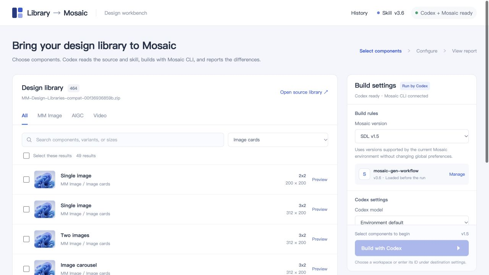

# Studio 8 AIX · Bing Design Components to Mosaic Workflow

A local workbench for recreating components from the Bing Multimedia design library as Mosaic templates. Select examples from MM Image, AIGC, and Video, then let **Codex follow a versioned workflow skill, inspect native Mosaic components and rules, build templates through Mosaic CLI, review screenshots, and report differences**.

The workbench runs on each user's own computer. GitHub provides distribution and collaboration; no website deployment or shared author account is required. The current implementation is a local tool, with a possible Codex plugin entry point planned for the future.

**English UI:** Version 0.4 uses English throughout the workbench and for new reports. Source content, user inputs, and historical reports retain their original language. See the [English quick start](docs/quick-start.en.md).



## Getting started

### 1. Prepare your environment

- **macOS or Linux with Python 3.9+.** On Windows, run the full workflow inside WSL2. Native Windows process management is not supported yet.
- **Codex CLI:** Follow the [official installation guide](https://developers.openai.com/codex/cli/). You can install it with `npm install -g @openai/codex`, then run `codex` in a terminal to sign in with your own account or configure your own provider. The CLI bundled with the Codex desktop app can also be used.
- **Mosaic CLI:** You need an account, network connection, and workspace with access to Microsoft Mosaic. The installation command below comes from the bundled skill's [setup reference](.agents/skills/mosaic-gen-workflow/references/api-and-iteration-workflow.md):

  ```sh
  curl -fsSL "https://afd-mosaic-f6e8eycvfaeffkam.b02.azurefd.net/api/cli/install" | bash
  mosaic login
  mosaic status
  ```

  If your terminal cannot find `mosaic`, open a new terminal or use `~/.mosaic/bin/mosaic`. Mosaic may require a corporate network or VPN. Access to this GitHub repository does not grant access to Mosaic.

The workbench does not install or change your provider, model, or global MCP settings, and it includes no account credentials. Generation uses your locally configured Codex environment, so access and usage depend on your own configuration.

### 2. Download and check the project

```sh
git clone https://github.com/ToddZhaoXY/Studio-8-AIX-Bing-Design-to-Mosaic-workflow.git
cd Studio-8-AIX-Bing-Design-to-Mosaic-workflow
python3 tools/mosaic-workbench/doctor.py
```

You can also choose **Code → Download ZIP** on GitHub, extract the complete archive, and open the extracted directory. The repository includes a verified Library ZIP of approximately 21 MB and the complete `mosaic-gen-workflow v3.6` skill. The workbench creates a local cache on first launch.

By default, `doctor.py` runs offline checks for Python, the source package, the skill, the catalog of 55 components and 464 examples, and CLI paths. It does not sign in, call a model, or create templates. You can browse the source library before installing the CLIs, but both CLIs must be available to start a build.

To check live connections explicitly, run:

```sh
python3 tools/mosaic-workbench/doctor.py --live
```

The live check reads your account environment. With a custom provider and no OAuth metadata, it may run a small read-only model probe. It does not create Mosaic templates. The execution layer uses experimental dynamic tools in Codex App Server, so your CLI must support that capability. Finding a CLI binary alone does not verify the full execution path.

### 3. Open the workbench

```sh
./start.sh
```

On macOS, you can also double-click **Start Mosaic Workbench.command**. The legacy launcher remains supported. The default URL is <http://127.0.0.1:8770>. To start without opening a browser automatically:

```sh
./start.sh --no-browser
```

If another checkout is using the port, run `./start.sh --port 8771`. The launcher will not take over a service belonging to another project. To run in the foreground and stop with Ctrl+C:

```sh
python3 tools/mosaic-workbench/server.py --port 8770
```

### 4. Choose an output destination and build

1. Search or filter components, preview the originals, and select the examples you want. Each batch supports up to 50 entries, enough for all 49 Image cards.
2. Wait for the Codex and Mosaic connection checks. **On first use, select your own workspace and an existing folder.** You can also enter their IDs manually.
3. Choose an available SDL version and a template name prefix. Optionally set the Codex model, reasoning effort, time limit per card, repair limit, and additional instructions.
4. Click **Build with Codex**. The defaults are 5 minutes per card and at most one repair. If an item fails or times out, saved drafts are kept and the batch continues with the next item.
5. Open **View report** or **History** to inspect template links, components and references used, icon choices, and differences. Expand the details for validation evidence, screenshots, and execution files.

For example: filter **Image cards** → select all → set the prefix to `MM_image_cards` → choose your team's workspace and folder → start the build.

Large batches can take a while. Closing the page does not stop the background service, but shutting down, sleeping, losing network access, or exiting the service can interrupt execution. Use **Stop batch** to stop a run. Restarting the workbench does not automatically rebuild interrupted templates, which helps avoid duplicates.

## Optional personal configuration

```sh
cp workbench.example.json workbench.local.json
```

`workbench.local.json` is ignored by Git. Use it to set CLI paths, a default workspace or folder, a compatible source package, or an image hosting URL. All fields are optional. **Do not put passwords or tokens in this file.**

| JSON field | Environment variable override | Default behavior |
| --- | --- | --- |
| `codexBinary` | `MOSAIC_WORKBENCH_CODEX_BIN` | Search `PATH`, then known macOS desktop CLI locations |
| `mosaicBinary` | `MOSAIC_WORKBENCH_MOSAIC_BIN` | Search `PATH`, then check `~/.mosaic/bin/mosaic` |
| `workspaceId` | `MOSAIC_WORKSPACE_ID` | Empty; selected by the user in the UI |
| `folderId` | `MOSAIC_FOLDER_ID` | `default`, subject to the folders you can actually access |
| `libraryZip` | `MOSAIC_LIBRARY_ZIP` | The compatible ZIP included in the repository |
| `assetBaseUrl` | `MOSAIC_ASSET_BASE_URL` | The existing public Library asset directory |

CLI paths can be absolute or relative to the repository. Leave them unset to use automatic discovery. Environment variables override the local JSON configuration. Restart the service after changing local settings. An existing `CODEX_HOME` is respected; the workbench does not change other applications' configuration.

Images loading in the local Library does not mean Mosaic can access `localhost`. Generated templates reference the public Library's HTTPS assets by default. To use different hosting, put the same assets in an HTTPS directory accessible to the target renderer and set `assetBaseUrl`. The tool checks assets against source digests and does not use a screenshot of the whole card as the recreated output. If a new ZIP changes the internal constructors or catalog structure, the extractor must be updated. This is not a general-purpose Figma or ZIP importer.

## Workflow skill and versions

- The complete [Mosaic Gen Workflow v3.6](.agents/skills/mosaic-gen-workflow/SKILL.md) is included. Codex can read it within this project, and the workbench creates a separate copy on first launch.
- Use **Skill → Import ZIP → Activate** to update the workflow independently. Running tasks keep the skill snapshot captured when they started.
- The [official update page](https://vibehub.microsoft.com/app/anthonyleung-fp-t-a/) may require corporate access.
- The current direct-write interface accepts only the SDL version pinned by the selected Mosaic profile. New work in this project defaults to v1.5. The version menu disables unverified or unsupported versions. **The workbench does not switch your global profile for an individual task.**
- If static skill examples contain an author's local paths or older interfaces, use your own CLI paths and the current version-specific contract.

## How it works and what the results mean

Each card runs in a separate, temporary Codex App Server session. Codex performs the authoring itself rather than forwarding the prompt to Mosaic autopilot. Through six controlled tools, it reads the source and skill, inspects native Mosaic contracts, writes JSX, schema, and data, saves the result, reviews screenshots, and records differences. Source material is read in sections rather than passed as one large prompt.

The execution layer enforces template ownership, output destination, time limits, and repair limits. Each request uses one working iteration; repairs upload only changed fields. Report updates are written locally. The workflow does not automatically publish templates or edit other people's existing templates.

Reports distinguish **saved output**, **structural validation**, **screenshot capture**, **Codex visual observations**, and **user acceptance**. Native canvas dimensions, icons, fonts, spacing, cropping, and interactions may differ from the Library source. Untested responsive, click, and keyboard behavior is never marked as passed. **Having 464 selectable examples does not mean all 464 have been accepted.** Features such as gallery dialogs do not yet have a complete general mapping; complex cards may time out or need further changes.

In two local prototype runs on November 12, 2026, a 3×2 single-image card and a 5×4 three-image card took 4 minutes 28 seconds and 4 minutes 24 seconds, respectively. Both were saved in one iteration and produced actual screenshots. These are historical results from a specific environment, not guarantees of performance or fidelity for other accounts or networks. Offline, clean-checkout, and live connection checks are separate validation steps. The author's historical run reports are not included in the shared repository.

## Project files and maintenance

```text
.agents/skills/mosaic-gen-workflow/   Complete workflow skill
MM_design_library/                  Verified source ZIP and digests
tools/mosaic-workbench/              Local UI, Codex runner, and controlled Mosaic tools
tools/library-to-mosaic/             ZIP validation and source extraction dependencies
scripts/                            Clean-environment verification scripts
outputs/mosaic-workbench/            Local generated outputs (ignored by Git)
tools/mosaic-workbench/state/        Local cache, skill copies, and job index (ignored by Git)
```

The UI and command-line client use the same execution path:

```sh
python3 tools/mosaic-workbench/client.py catalog --search single-image
python3 tools/mosaic-workbench/client.py run \
  --select mm-image/image-cards/2x2/single-image \
  --workspace YOUR_WORKSPACE_ID --folder default \
  --prefix MM_image_cards --version v1.5
```

Repeat `--select` to choose multiple entries. For a different port, use `client.py --url http://127.0.0.1:8771 ...`. Omitting `--model` uses the default model in your own environment.

Before updating, let active batches finish or stop them, then run `git pull` and restart the service. Personal run data, authentication, and `workbench.local.json` are not committed. Keep these local files when updating instead of deleting the entire project directory.

To run the local checks:

```sh
python3 -m unittest discover -s tools/mosaic-workbench/tests -v
python3 -m unittest discover -s tools/library-to-mosaic/tests -v
python3 scripts/smoke_test.py
```

[Troubleshooting](docs/troubleshooting.md) · [Verification records](docs/verification.md) · [Optional CI](docs/ci.md) · [Sources and notices](THIRD_PARTY_NOTICES.md)
