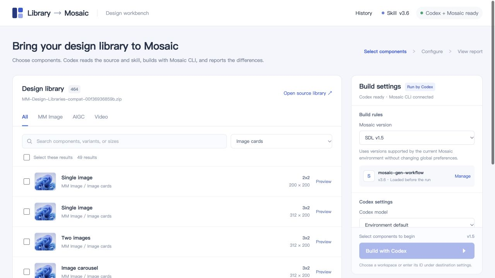

# English interface verification — 0.4.0

Date: 2026-11-16.

## Scope

The workbench UI, built-in API errors, progress messages, CLI diagnostics, and instructions for new reports use English. Source card text, user inputs, and existing report prose are preserved. No translation or mutation of the Library ZIP or bundled skill was performed.

## Checks completed

- 116 workbench Python tests and 11 source-package tests passed.
- 16 isolated local HTTP checks passed, including `lang=en`, `uiLanguage=en`, empty-selection errors, rejected skill packages, missing-session-token errors, and preservation of original Chinese input text. No task execution was started by these checks.
- Browser checks covered filtering, selection, empty search results, original component previews, skill management, empty history, and an invalid destination request rejected before generation.
- Isolated, explicitly labeled UI fixtures covered history rows, needs-review and timeout reports, reference usage, difference tables, icon matching, expanded evidence, and preservation of existing Chinese report text. These fixtures were not added to real task history.
- English layouts were checked at 1280×720 and 390×844, with no horizontal document overflow. The desktop action button remained visible.
- A temporary Mosaic extension-profile timeout was displayed in readable English with a connection-attention state. A subsequent connection check recovered. No real template generation was requested for this interface change.

These are interface and regression checks, not a new acceptance of Mosaic rendering fidelity or of every source component.
